# MERN — Session 1: My First Express Server (The Blog API)

> École Polytechnique de Sousse — 2026/2027 · Dr. Abdelweheb GUEDDES
> Lab report — **Amir Kerkeni**

An HTTP-compliant backend built with **Node.js + Express**, exposing a REST Blog API
with an in-memory data store. Every step below was executed and captured.

| | |
|---|---|
| **Stack** | Node.js v22.17.1 · npm 10.9.2 · Express 5 |
| **Run** | `npm install` then `npm run dev` → http://localhost:3000 |
| **Files** | [`server.js`](server.js) · [`exercices_js.js`](exercices_js.js) |

---

## Step 1 — Environment setup

Verify that the runtime and the package manager are installed:

```powershell
node -v
npm -v
```

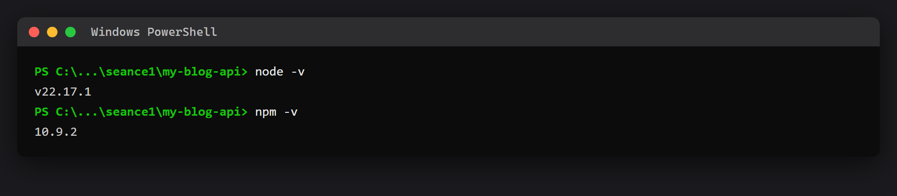

Initialize the project, install Express and place the folder under version control:

```powershell
mkdir my-blog-api
cd my-blog-api
npm init -y
npm install express
git init
```

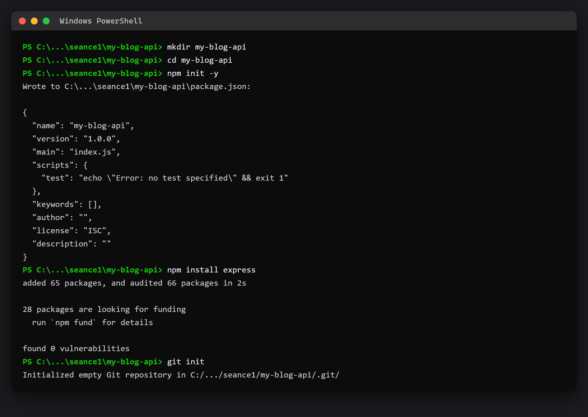

A `.gitignore` containing `node_modules/` is added, and `package.json` gets a `dev`
script so that Node's `--watch` flag reloads the process on every save:

```json
"scripts": {
  "dev": "node --watch server.js"
}
```

---

## Step 2 — A minimal server

`server.js` loads Express, declares a single `GET /` route and binds to port 3000.

```js
const express = require('express');
const app = express();
const PORT = 3000;

app.get('/', (req, res) => {
  res.json({ message: "Hello, I am the blog API" });
});

app.listen(PORT, () => {
  console.log(`Server running at http://localhost:${PORT}`);
});
```

```powershell
npm run dev
```

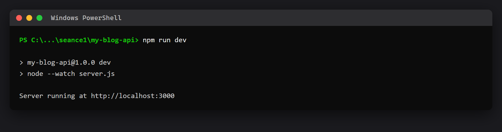

**Checkpoint —** the browser acts as an HTTP client: it issues `GET /` and renders the JSON payload.

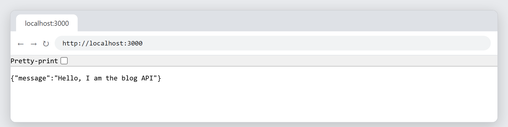

> Commit: `Minimal server`

---

## Step 3 — The article collection

Articles live in an in-memory array; `res.json` serializes it to JSON.

```js
const articles = [
  { id: 1, title: 'Welcome to the blog', author: 'Admin' },
  { id: 2, title: 'My first Express server', author: 'Aya' },
  { id: 3, title: 'Testing an API with Postman', author: 'Aya' }
];

app.get('/api/articles', (req, res) => {
  res.json({ total: articles.length, articles: articles });
});
```

**Checkpoint —** `/api/articles` returns `"total": 3` and the three articles.

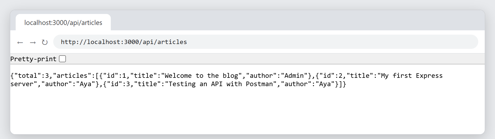

---

## Step 4 — Fetch a single article by ID

The `:id` route parameter is exposed through `req.params.id` — always a **string**,
hence the `Number(...)` cast before the strict comparison.

```js
app.get('/api/articles/:id', (req, res) => {
  const id = Number(req.params.id);
  const article = articles.find(a => a.id === id);

  if (!article) {
    return res.status(404).json({ error: `Article ${id} not found` });
  }
  res.json(article);
});
```

Existing resource → `200 OK` with the article:

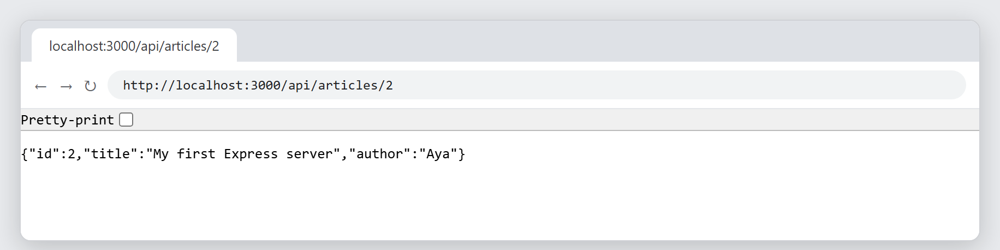

Missing resource → the error is handled gracefully with a structured payload and `404`:

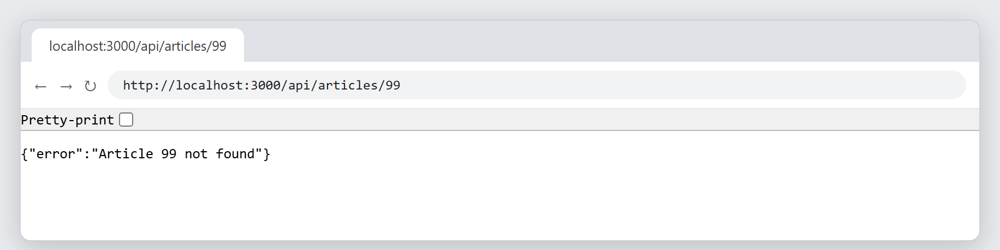

> **Prediction vs. observation.** The segment `2` arrives as a **string**. Removing
> `Number(...)` makes `"2" === 2` evaluate to `false`, so `find` returns `undefined`
> and the route answers `404` — which confirms why the cast is mandatory.
>
> `return` must precede `res.status(404)`: an HTTP exchange allows exactly **one**
> response, and `return` stops the handler before a second one is sent.

> Commit: `GET routes`

---

## Step 5 — Filter by query parameter

Everything after `?` is parsed into `req.query`; destructuring extracts it cleanly
and `filter` returns every matching element.

```js
app.get('/api/articles', (req, res) => {
  const { author } = req.query;

  let result = articles;
  if (author) {
    result = articles.filter(a => a.author === author);
  }
  res.json({ total: result.length, articles: result });
});
```

`?author=Aya` → `total: 2`:

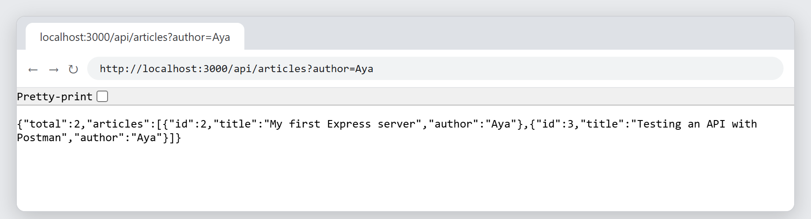

`?author=Omar` → `total: 0` and an empty array (`filter` never returns `undefined`):

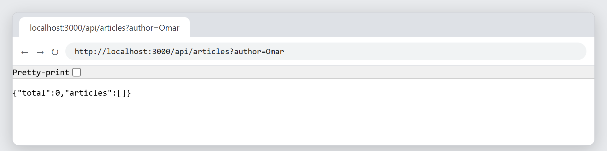

| URL | Predicted `total` | Observed `total` |
|---|---|---|
| `/api/articles` | 3 | 3 |
| `/api/articles?author=Aya` | 2 | 2 |
| `/api/articles?author=Omar` | 0 | 0 |

---

## Step 6 — Create an article via POST

`express.json()` is registered **before** the routes: it parses the raw JSON body of
incoming requests and exposes it as `req.body`.

```js
app.use(express.json());

let nextId = 4;

app.post('/api/articles', (req, res) => {
  const { title, author } = req.body;

  if (!title || !author) {
    return res.status(400).json({ error: "Title and author are required" });
  }

  const newArticle = { id: nextId, title: title, author: author };
  nextId = nextId + 1;
  articles.push(newArticle);

  res.status(201).json({ message: 'Article created', article: newArticle });
});
```

---

## Step 7 — Testing the endpoints

Requests were issued with `curl -i`, which prints the HTTP status line and the
response headers alongside the payload.

**Valid payload → `201 Created`**, the new article receives `id: 4`:

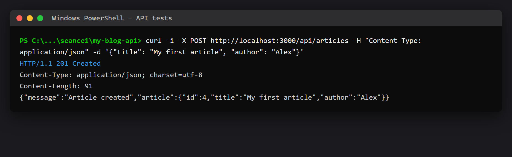

The collection now reports `"total": 4`:

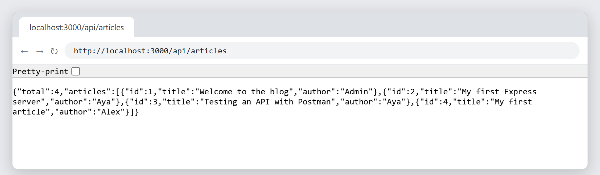

**Missing `author` → `400 Bad Request`**, the validation rejects the request:

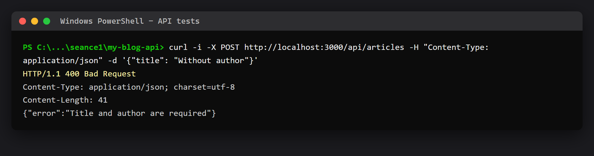

| Method | URL | Payload | Predicted | Observed |
|---|---|---|---|---|
| `GET` | `/api/articles` | — | 200 | **200** |
| `POST` | `/api/articles` | `{ "title": "My first article", "author": "Alex" }` | 201 | **201** |
| `GET` | `/api/articles/4` | — | 200 | **200** |
| `POST` | `/api/articles` | `{ "title": "Without author" }` | 400 | **400** |
| `GET` | `/api/articles/99` | — | 404 | **404** |

> Restarting the process resets `total` to 3: the data lives in volatile RAM, which
> is precisely why Session 3 introduces MongoDB.
>
> Commit: `Article creation`

---

## Assignment — Exercise 1: Extend the API

### 1. `GET /about` — application metadata

```js
app.get('/about', (req, res) => {
  res.json({ application: 'Blog API', student: 'Amir Kerkeni', version: '1.0.0' });
});
```

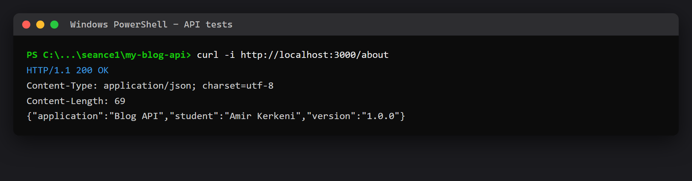

### 2. `GET /api/users` — the user collection

```js
const users = [
  { id: 1, name: 'Aya', email: 'aya@example.com' },
  { id: 2, name: 'Omar', email: 'omar@example.com' },
  { id: 3, name: 'Alex', email: 'alex@example.com' }
];
```

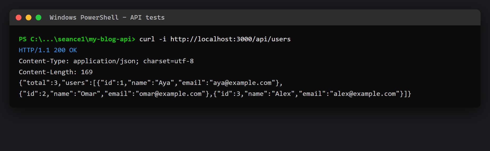

### 3. `GET /api/users/:id` — success and error cases

```js
app.get('/api/users/:id', (req, res) => {
  const id = Number(req.params.id);
  const user = users.find(u => u.id === id);

  if (!user) {
    return res.status(404).json({ error: `User ${id} not found` });
  }
  res.json(user);
});
```

`/api/users/2` returns Omar with `200 OK`; `/api/users/99` returns a structured error with `404`:

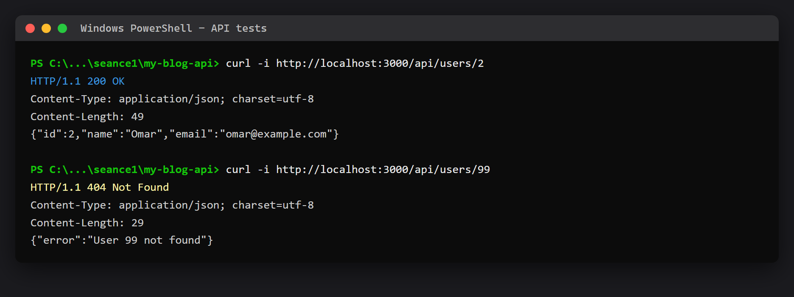

### 4. `POST /contact` — validated submission

```js
app.post('/contact', (req, res) => {
  const { email, message } = req.body;

  if (!email || !message) {
    return res.status(400).json({ error: "Email and message are required" });
  }
  res.status(200).json({ message: "Thank you, your message has been received" });
});
```

A complete body returns `200 OK`; omitting `message` returns `400 Bad Request`:

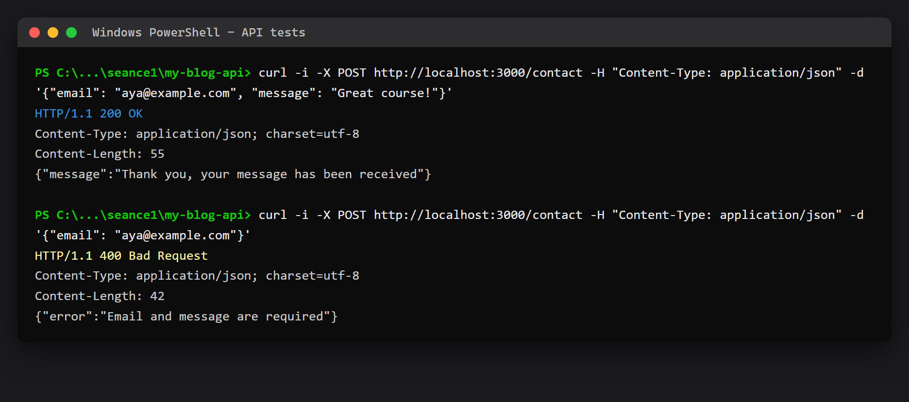

### 5. Bonus — `GET /api/users?name=Aya`

The same `req.query` + `filter` idiom as Step 5, applied to the user collection:

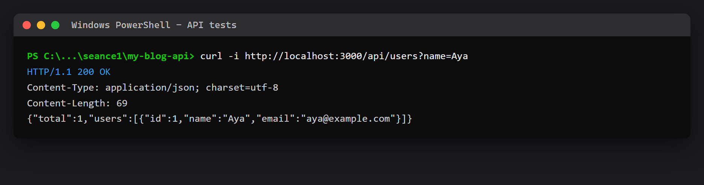

---

## Assignment — Exercise 2: Essential JavaScript idioms

[`exercices_js.js`](exercices_js.js) exercises destructuring, `find`, `filter` and arrow functions:

```js
const { name, price } = products[0];        // destructuring
const mouse = products.find(p => p.name === 'Mouse');
const cheap = products.filter(p => p.price < 100);
const withDiscount = (p) => p * 0.9;        // arrow function
```

```powershell
node exercices_js.js
```

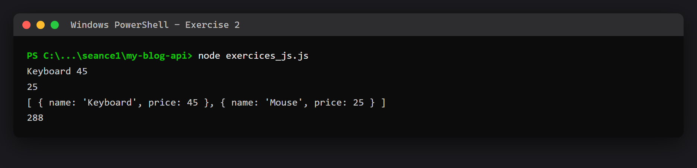

The terminal output matches the expected result from the lab subject exactly.

---

## Version control

The repository history follows the checkpoints of the lab guide; `node_modules/` is
excluded through `.gitignore` and never committed.

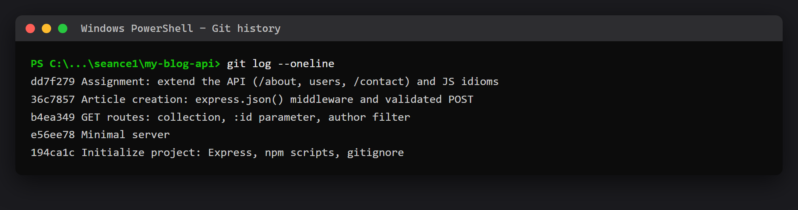

---

## API reference

| Method | Endpoint | Description | Status |
|---|---|---|---|
| `GET` | `/` | Welcome message | `200` |
| `GET` | `/about` | Application name, student, version | `200` |
| `GET` | `/api/articles` | All articles (`?author=` filters) | `200` |
| `GET` | `/api/articles/:id` | One article | `200` / `404` |
| `POST` | `/api/articles` | Create an article (`title`, `author`) | `201` / `400` |
| `GET` | `/api/users` | All users (`?name=` filters) | `200` |
| `GET` | `/api/users/:id` | One user | `200` / `404` |
| `POST` | `/contact` | Submit a message (`email`, `message`) | `200` / `400` |

## Key takeaways

1. The web is a conversation: the client sends a request (verb + URL + optional JSON body), the server answers with a status code and a payload.
2. Clients transmit parameters through three channels: `req.params`, `req.query` and `req.body` (the latter requires `express.json()`).
3. Exactly **one** response per request — hence `return res.status(...)`.
4. URL parameters always arrive as **strings**: cast with `Number(...)` before strict comparison.
5. In-memory state is volatile; persistence arrives with MongoDB in Session 3.
